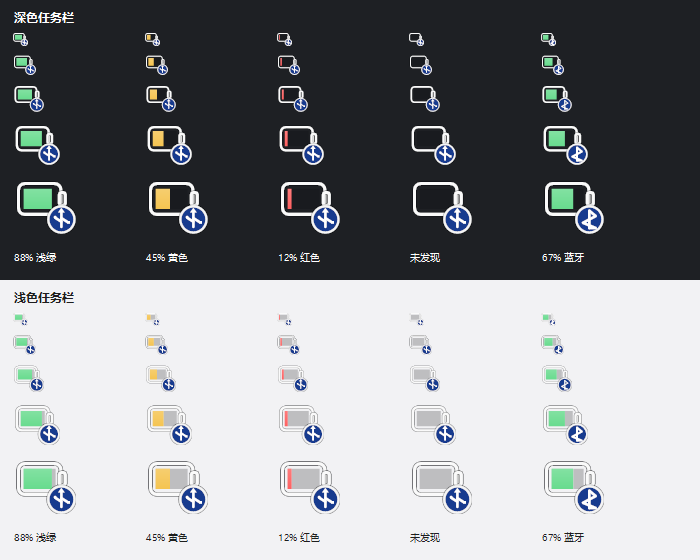
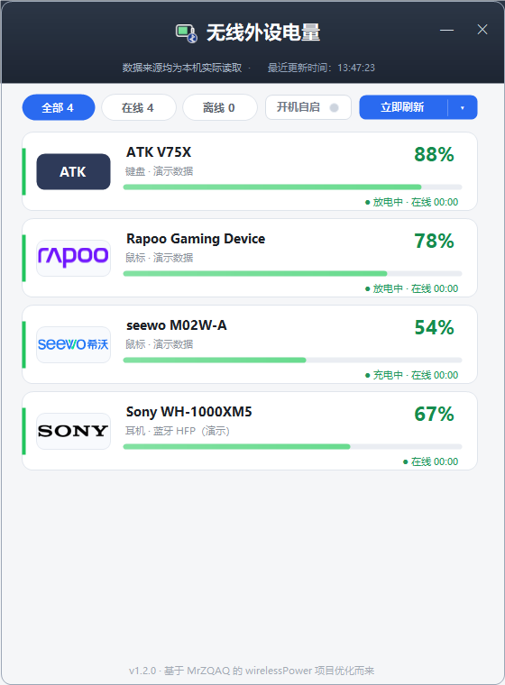

> 📦 **本文件是上游原始 README 的存档，仅供对照历史版本使用。**
>
> - 来源：[`MrZQAQ/wirelessPower`](https://github.com/MrZQAQ/wirelessPower) 的 `master` 分支
>   （提交 `5d3f4e1`），按 MIT 许可证保留原文。
> - 内容描述的是**上游原始版本**，其中的功能、命令行参数、依赖（如「无第三方 NuGet 依赖」）
>   与离线判定方式**与当前版本不符**。
> - 当前版本请阅读 [README.md](README.md)。

---

# 无线外设电量托盘

**2.4G + Bluetooth battery monitor for Windows**

[](https://www.microsoft.com/windows)
[](https://dotnet.microsoft.com/download/dotnet/10.0)
[](LICENSE)
[](BatteryTray.csproj)

一个 Windows 10/11 x64 的托盘工具，通过 **USB HID / Windows 蓝牙 PnP 属性**读取 2.4G 无线接收器和蓝牙外设的电量，并在通知区域显示一个「电池 + 角标」图标。

> 不联网、不上传、不写日志；只依赖 .NET 10 Desktop Runtime。

---

## 目录

- [功能特性](#功能特性)
- [界面预览](#界面预览)
- [支持的设备](#支持的设备)
- [系统要求](#系统要求)
- [快速开始](#快速开始)
- [使用方式](#使用方式)
- [命令行](#命令行)
- [配置与数据](#配置与数据)
- [工作原理](#工作原理)
- [项目结构](#项目结构)
- [从源码构建](#从源码构建)
- [故障排查](#故障排查)
- [已知限制](#已知限制)
- [隐私](#隐私)
- [贡献](#贡献)
- [许可证](#许可证)
- [致谢](#致谢)

## 功能特性

- **2.4G 与蓝牙统一展示**：USB 接收器外设和蓝牙外设出现在同一个托盘图标与详情窗口中。
- **最低电量优先**：多台设备同时连接时，托盘电池图标填充量取最低电量设备。
- **颜色阈值**：`≥60%` 浅绿、`20%–60%` 黄色、`<20%` 红色。
- **USB / 蓝牙角标**：2.4G 设备显示 USB 角标，蓝牙设备显示蓝牙角标。
- **按设备悬浮信息**：鼠标悬停时逐行显示设备名称、电量和状态；蓝牙未连接设备不会参与聚合。
- **详情窗口**：大号电量、进度条、设备类型、数据来源和更新时间；支持多设备滚动。
- **最小化到托盘**：详情窗口使用系统标准最小化按钮，最小化后从任务栏隐藏，托盘图标或再次启动程序可恢复。
- **可调刷新间隔**：30 秒、1 分钟、2 分钟、5 分钟、10 分钟、30 分钟。
- **开机自启动**：主界面底部开关，写入当前用户的 Windows 启动项；移动 EXE 后下次运行会自动修正路径。
- **上次更新时间**：主界面摘要和右键菜单都会显示本轮读取完成时间。
- **单实例**：重复启动不会产生第二个托盘程序，而是唤起已运行实例的详情窗口。
- **休眠兜底**：Rapoo 深度休眠时显示最近一次成功读数，标记为“上次”。
- **单文件发布**：框架依赖单文件 EXE，约 1 MB；不需要打包或解压 .NET runtime。
- **本地运行**：不包含 HTTP、socket、遥测或自动更新逻辑。

## 界面预览

托盘图标在不同背景、尺寸和电量下的效果：



设备详情窗口（演示数据）：



## 支持的设备

### 已实机验证

| 设备 | 标识 | 读取方式 | 实测 |
|---|---|---|---|
| ATK V75X / VXE V75 Pro 2.4G | `320F:5088` | ATK/VXE EVISION 私有协议，Report ID 4 | 88% |
| Rapoo Gaming Device | `24AE:146D` | Rapoo 状态广播，Report ID 7 | 77% |
| Sony WF-1000XM3 蓝牙耳机 | `BTHENUM` | Windows Bluetooth HFP PnP 电量属性 | 100%（连接时） |

### 协议适配

| 设备类型 | 标识 | 说明 |
|---|---|---|
| DARKRIM SHADOW 耳机 | `3654:6901` | 杰理 TLV 协议，CRC16-CCITT-FALSE |
| ATK / VXE 无线鼠标 | `373B:*`、`3554:*` 等 | 64 字节 / 17 字节 Output Report 协议 |
| Endgame Gear 无线鼠标 | `3367:*` | Feature Report `0xA1` |
| VAXEE / ZYGEN 无线鼠标 | `3057:*` | Feature Report `0x0E` |
| Nordic nRF 方案接收器 | `1915:*` | Feature Report `0x05` |
| Logitech HID++ 2.0 | `046D:*` | HID++ `0x1000` / `0x1004` |
| 标准 HID 电量字段 | 任意 | Usage `0x0006/0x0020` 等 |
| 其他蓝牙耳机/鼠标/键盘/手柄 | `BTHENUM` / `BTHLE` | 仅显示当前已连接且上报 PnP 电量的设备 |

> 私有协议来自公开资料与实机抓包，**与固件、接收器批次和厂商驱动版本有关**。不同型号或固件可能返回不同字节；遇到不支持设备时，请先用 `--probe` 导出接口信息，再参考 [贡献](#贡献) 提交适配。

蓝牙设备只显示**当前已连接**的节点：

- 经典蓝牙通过 `BluetoothFindFirstDevice` 的 `fConnected` 判断；
- BLE 节点通过 `DEVPKEY_Bluetooth_LastConnectedTime` 过滤长时间未连接设备；
- 已配对但未连接的设备不会出现在列表，也不会影响最低电量。

## 系统要求

### 运行

- Windows 10 / Windows 11，x64
- **.NET 10 Desktop Runtime（Windows x64）**

  <https://dotnet.microsoft.com/download/dotnet/10.0>

> 请安装 **Desktop Runtime**，不是普通的 .NET Console Runtime。程序使用 WinForms，缺少 WindowsDesktop runtime 时无法启动。

### 构建

- Windows 10/11 x64
- .NET 10 SDK（LTS）
- 无第三方 NuGet 依赖

## 快速开始

1. 安装 **.NET 10 Desktop Runtime（x64）**。
2. 下载或复制 [2.4G-Battery-Tray.exe](dist/2.4G-Battery-Tray.exe) 到普通目录（例如桌面或 `C:\Tools`）。
3. 双击运行，等待约 3 秒。
4. 点击任务栏右下角的 `^`，找到“无线外设电量”，可拖到任务栏，或前往：

   **设置 → 个性化 → 任务栏 → 其他系统托盘图标**

5. 左键托盘图标查看详情，右键打开菜单。

> **启动方式很重要**：请从文件资源管理器双击运行。不要从受限终端、AI 文件面板或低权限沙箱启动，否则 Windows 会拒绝 `Shell_NotifyIcon` 注册，程序可能只能看到进程而没有托盘图标。

## 使用方式

| 操作 | 行为 |
|---|---|
| 鼠标悬停托盘图标 | 第一行显示最低电量；后续每行显示一台设备的名称、电量和状态 |
| 左键单击 | 打开详情窗口 |
| 右键单击 | 立即刷新 / 刷新间隔 / 设备详情 / 退出 |
| 详情窗口最小化按钮 | 隐藏到托盘，不占用任务栏 |
| 详情窗口底部“开机自启动” | 开启/关闭当前用户的开机自启动 |
| 再次启动 EXE | 唤起已运行实例的详情窗口，不创建第二份进程 |
| 详情窗口刷新 | 立即读取一次，并更新托盘图标和悬浮文本 |

- 默认刷新间隔：**60 秒**
- 设置和缓存位于 `%LOCALAPPDATA%\2.4GBatteryTray`
- 低电量不会弹窗打扰；仅在托盘图标颜色和悬浮信息中体现

开机自启动是**当前用户级**设置，不请求管理员权限，也不会创建系统服务。在详情窗口底部勾选“开机自启动”即可；取消勾选会删除启动项。若移动了 EXE，下次手动运行时会自动把启动项修正为新路径。

## 命令行

```text
2.4G-Battery-Tray.exe --demo
2.4G-Battery-Tray.exe --probe result.json
2.4G-Battery-Tray.exe --icon-preview icons.png
2.4G-Battery-Tray.exe --ui-preview window.png
2.4G-Battery-Tray.exe --make-icon app.ico
2.4G-Battery-Tray.exe --tray-info trayinfo.txt
```

| 参数 | 说明 |
|---|---|
| `--demo` | 使用 4 台模拟设备启动，便于查看多设备和蓝牙效果 |
| `--probe <file>` | 不显示窗口，读取一次并输出 JSON。包含 HID 接口、设备结果、悬浮文本 |
| `--icon-preview <png>` | 生成不同电量、尺寸、深色/浅色背景的图标预览 |
| `--ui-preview <png>` | 生成详情窗口截图 |
| `--make-icon <ico>` | 生成多尺寸应用图标 |
| `--tray-info <txt>` | 输出托盘注册诊断信息：`added`、窗口句柄、`Shell_NotifyIconGetRect`、`testAdd` |

`--probe` 输出示例：

```json
{
  "MinimumLevel": 77,
  "Tooltip": "无线外设 最低77% · 21:06\nATK V75X  88%\nRapoo Gaming Device  77%\nWF-1000XM3  100%",
  "devices": [
    { "Name": "ATK V75X", "Kind": "Keyboard", "Level": 88 },
    { "Name": "Rapoo Gaming Device", "Kind": "Mouse", "Level": 77 },
    { "Name": "WF-1000XM3", "Kind": "Headset", "Level": 100 }
  ]
}
```

> `--probe` 是排查设备兼容性的首选入口；提交 Issue 时请附上该 JSON（可先删除包含个人设备名的字段）。

## 配置与数据

| 文件 | 用途 |
|---|---|
| `%LOCALAPPDATA%\2.4GBatteryTray\settings.json` | 刷新间隔、首次运行提示状态 |
| `%LOCALAPPDATA%\2.4GBatteryTray\last-readings.json` | 最近成功的设备读数，用于休眠时显示“上次” |
| `HKCU\Software\Microsoft\Windows\CurrentVersion\Run\2.4GBatteryTray` | 开机自启动命令（仅在启用时存在） |

- 缓存最长保留 **36 小时**；超过后不再作为回退值。
- 设备断开时不会把缓存中的设备继续显示为在线设备（蓝牙节点尤其如此）。
- 不创建日志文件；默认没有任何遥测。

## 工作原理

```text
2.4G USB HID 接口 ──> 协议适配器 ─────────┐
                                           ├──> BatteryMonitor ──> 读数缓存
Bluetooth HFP / BLE PnP 属性 ──> 连接过滤 ─┘         │
                                                      ├──> 托盘图标渲染
                                                      └──> 详情窗口 / Tooltip
```

关键实现：

- **HID 层**：`setupapi.dll` + `hid.dll` 枚举接口和能力表；每个接口使用独立的 `FILE_FLAG_OVERLAPPED` 读句柄。
- **超时处理**：读超时调用 `CancelIoEx`，避免“阻塞读 + 并发写”导致进程崩溃。
- **写报告**：优先 `WriteFile` 发送完整 Output Report。部分 2.4G 接收器上 `HidD_SetOutputReport` 会返回成功但不实际发送，因此不能只依赖该 API。
- **ATK/VXE EVISION**：63 字节私有帧，命令 `0x1A`；响应数据第 7 字节为电量，第 8 字节为充电标志。
- **Rapoo**：状态接口 Report 7；主动状态请求后读取广播，电量在状态包第 7 个数据字节。
- **DARKRIM**：65 字节 TLV，CRC16-CCITT-FALSE，TLV `0x01` 为电量。
- **蓝牙**：读取 Windows 在 Hands-Free / 免提节点上维护的 PnP 属性 `{104EA319-6EE2-4701-BD47-8DDBF425BBE5}, 2`；使用 `BluetoothFindFirstDevice` 和 `LastConnectedTime` 过滤未连接节点。
- **图标**：GDI+ 运行时绘制电池、电量填充、USB / 蓝牙角标，并生成多尺寸 ICO。
- **单实例**：命名 Mutex + 命名事件；第二次启动只唤起详情窗口。

## 项目结构

```text
.
├─ BatteryTray.csproj          # .NET 10 WinForms 项目
├─ app.manifest                # DPI / Windows 兼容性清单
├─ Assets/
│  └─ app.ico                  # 应用图标
├─ docs/
│  ├─ tray-icons.png           # 图标预览
│  └─ ui-preview.png           # 详情窗口预览
├─ src/
│  ├─ Program.cs               # 入口、单实例、CLI
│  ├─ TrayApplicationContext.cs# 托盘、菜单、定时刷新
│  ├─ AutoStartManager.cs       # 当前用户开机自启动
│  ├─ AppSettings.cs           # 设置持久化
│  ├─ ReadingCache.cs          # 休眠读数缓存
│  ├─ SecurityContext.cs       # 完整性级别检查
│  ├─ Hid/
│  │  ├─ HidNative.cs          # Win32 P/Invoke
│  │  ├─ HidDevice.cs          # 读写封装
│  │  ├─ HidEnumerator.cs      # HID 枚举
│  │  ├─ BatteryMonitor.cs     # 多适配器聚合
│  │  └─ Protocols/            # 各厂商协议适配器
│  ├─ Bluetooth/
│  │  └─ BluetoothBatteryReader.cs
│  └─ UI/
│     ├─ BatteryIconRenderer.cs
│     └─ DeviceDetailsForm.cs
├─ dist/
│  └─ 2.4G-Battery-Tray.exe    # 已构建单文件
├─ README.md
└─ LICENSE
```

## 从源码构建

```powershell
dotnet publish BatteryTray.csproj -c Release -r win-x64 --self-contained false -o dist
```

项目已配置：

- `PublishSingleFile=true`
- `SelfContained=false`
- `RuntimeIdentifier=win-x64`
- `EnableCompressionInSingleFile=false`
- 不裁剪（WinForms 不建议 Trim）

产物：

```text
dist\2.4G-Battery-Tray.exe
```

程序约 1 MB，运行时由目标机的 **.NET 10 Desktop Runtime** 提供，构建阶段不再下载 self-contained runtime packs。

> 如果从带 `Low` 完整性标签的沙箱工作区构建，生成的 EXE 也可能继承该标签，导致 Windows 以低权限启动并拒绝托盘注册。发布后可执行：
>
> ```powershell
> icacls "dist\2.4G-Battery-Tray.exe" /setintegritylevel Medium
> ```
>
> 或把 EXE 复制到桌面/普通目录后再运行。

## 故障排查

### 任务管理器有进程，但托盘没有图标

1. 确认 EXE 的完整性标签不是 `Low`：

   ```powershell
   icacls "dist\2.4G-Battery-Tray.exe"
   ```

   如果是 `Mandatory Label\Low`，执行：

   ```powershell
   icacls "dist\2.4G-Battery-Tray.exe" /setintegritylevel Medium
   ```

   或复制到桌面/普通目录后运行。

2. 确认从**文件资源管理器**启动，而不是从受限终端、AI 文件面板或沙箱启动。
3. 点击任务栏 `^`，检查“无线外设电量”是否在隐藏图标中。
4. 打开 **设置 → 个性化 → 任务栏 → 其他系统托盘图标**，启用该程序。
5. 仍无图标时运行：

   ```powershell
   "dist\2.4G-Battery-Tray.exe" --tray-info "%USERPROFILE%\Desktop\trayinfo.txt"
   ```

   重点检查：

   ```text
   added=True
   testAdd=True
   Shell_NotifyIconGetRect hr=0x00000000
   ```

   `testAdd=False, error=5` 表示进程仍是低权限；`testAdd=True` 但设置里没有条目，通常是 Explorer 通知区域状态异常，可在任务管理器里重启 Windows Explorer。

### 提示缺少 .NET

安装 **.NET 10 Desktop Runtime x64**，而不是只安装 .NET SDK 或 Console Runtime：

<https://dotnet.microsoft.com/download/dotnet/10.0>

### 蓝牙设备不显示

- 确认设备当前已连接，且 Windows 设置中能看到它的电量。
- 已配对但未连接的设备会被过滤。
- 部分蓝牙设备不上报 HFP/BLE 电量属性，本程序无法凭空读取。
- 可运行 `--probe` 查看是否有对应 `BTHENUM` / `BTHLE` 节点。

### Rapoo 显示“上次读数”

Rapoo 的电量来自被动状态包，深度休眠时无法主动唤醒。程序会显示 36 小时内的最近一次成功读数；移动鼠标唤醒后，下一次刷新会自动更新。

### 某台 2.4G 设备无法读取

私有协议与固件强相关。请提交：

- 设备型号、VID:PID
- `--probe` 输出
- 接收器/固件版本（如果知道）

## 已知限制

- 仅支持 **Windows x64**，不支持 ARM64/x86。
- 需要 **.NET 10 Desktop Runtime**；不提供自包含版本。
- 蓝牙电量依赖 Windows 驱动上报的 PnP 属性，不直接实现各品牌蓝牙私有查询协议。
- 私有 2.4G 协议可能随固件/批次变化。
- 不提供开机自启、低电量通知、历史曲线或多语言界面（欢迎 PR）。
- 蓝牙深度休眠设备可能停留在“上次读数”，直到重新连接或上报新状态。

## 隐私

- 无 HTTP、WebSocket、socket、遥测或自动更新。
- 设备名、VID/PID、电量仅在本机内存和上述两个 JSON 文件中使用。
- `--probe` 会导出设备名和接口信息，提交 Issue 前请自行检查是否包含敏感内容。

## 贡献

欢迎提交 Issue 和 Pull Request。

### 报告设备兼容问题

请尽量附上：

1. 设备型号、USB VID:PID / 蓝牙地址前缀
2. 操作系统版本
3. `--probe` 生成的 JSON
4. 如果能抓包，请附上 HID Report Descriptor 和请求/响应十六进制数据

### 新增协议适配

完整接口、代码模板、超时和测试说明见：[`src/Hid/Protocols/README.md`](src/Hid/Protocols/README.md)。

1. 在 `src/Hid/Protocols/` 新建 `IProtocolAdapter` 实现。
2. 在 `BatteryMonitor` 的适配器列表中按优先级注册。
3. 只读查询，避免发送会修改设备配置的写入命令。
4. 为设备休眠/超时/无效电量增加防御性处理。
5. 在 PR 中说明测试设备、固件和验证结果。

### 代码约束

- C# / .NET 10，`nullable` 开启
- 不引入不必要的第三方依赖
- UI 线程与 HID 后台读取分离
- 不记录设备数据到日志

## 许可证

本项目使用 [MIT License](LICENSE)。

私有协议仅用于设备互操作与学习研究。本项目与 ATK、VXE、Rapoo、Sony、Logitech、DARKRIM 等厂商无关联，也未获得其官方授权。

## 致谢

- 协议与思路参考：[yszyszysz233/2.4G-battery-viewer](https://github.com/yszyszysz233/2.4G-battery-viewer)
- Rapoo 协议参考：[Nuitfanee/ClickSync](https://github.com/Nuitfanee/ClickSync)
- ATK/VXE EVISION 协议参考：ATK HUB Web 版前端协议

如果这个项目对你有帮助，欢迎 Star、提交设备适配或分享给需要的人。
