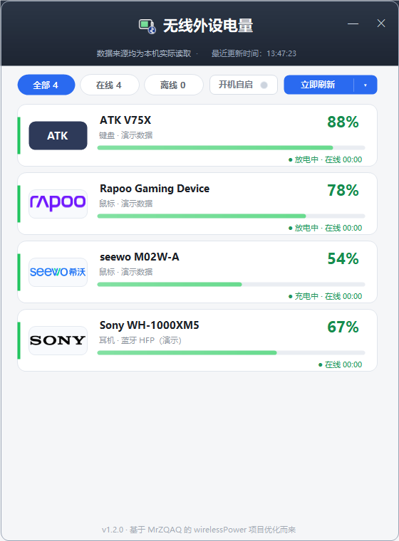
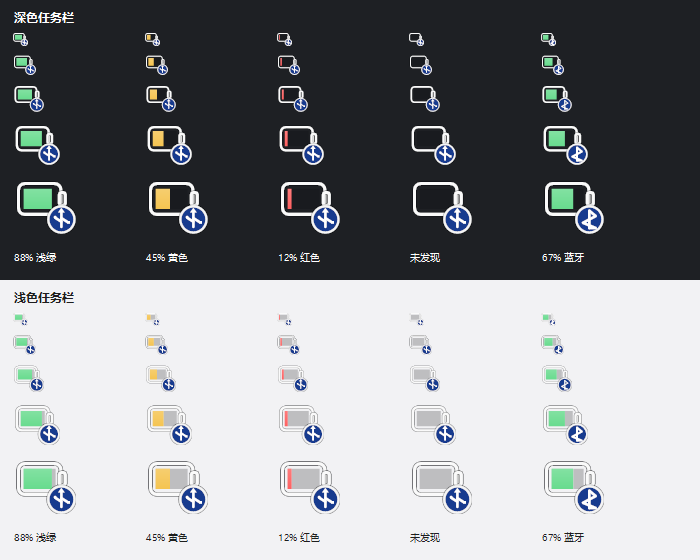
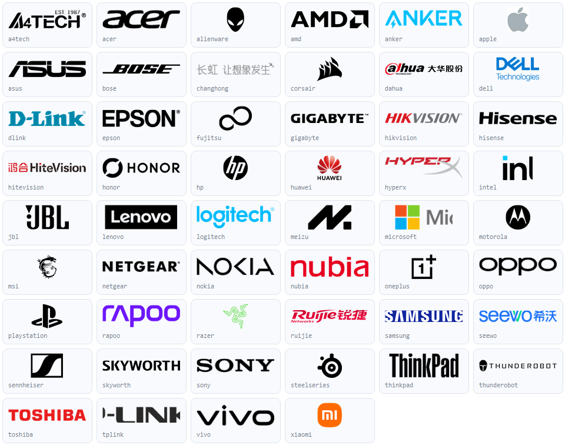

# 无线外设电量托盘

**2.4G + Bluetooth battery monitor for Windows**

[](https://www.microsoft.com/windows)
[](https://dotnet.microsoft.com/download/dotnet/10.0)
[](LICENSE)
[](BatteryTray.csproj)

一个 Windows 10/11 x64 的托盘工具：通过 **USB HID** 读取 2.4G 无线接收器的电量，通过 **Windows 蓝牙 PnP 属性 + WinRT 连接状态** 读取蓝牙外设的电量，并在通知区域显示一个「电池 + 角标」图标。

> 不联网、不上传、不写日志；只依赖 .NET 10 Desktop Runtime。

> ⚠️ **本项目是 [`MrZQAQ/wirelessPower`](https://github.com/MrZQAQ/wirelessPower) 的衍生版本。**
> 上游原始代码按 MIT 许可证发布，版权声明与许可原文完整保留在
> [`THIRD-PARTY-NOTICES.md`](THIRD-PARTY-NOTICES.md)；上游原始 README 存档见
> [`README-UPSTREAM.md`](README-UPSTREAM.md)。
> 本衍生版本（含全部修改与新增代码）按 [CC BY-NC-SA 4.0](LICENSE) 授权：
> **禁止商业使用；衍生作品必须公开源代码并以相同协议共享，不得闭源。**

---

## 目录

- [下载](#下载)
- [功能特性](#功能特性)
- [界面预览](#界面预览)
- [支持的设备](#支持的设备)
- [系统要求](#系统要求)
- [使用方式](#使用方式)
- [低电量提醒与语音播报](#低电量提醒与语音播报)
- [命令行](#命令行)
- [配置与数据](#配置与数据)
- [工作原理](#工作原理)
- [项目结构](#项目结构)
- [从源码构建](#从源码构建)
- [故障排查](#故障排查)
- [已知限制](#已知限制)
- [隐私](#隐私)
- [贡献](#贡献)
- [许可证](#许可证)
- [致谢](#致谢)

## 下载

前往 **[Releases](https://github.com/qzwl/wirelessPower/releases/latest)** 下载单文件版本：

```text
2.4G-Battery-Tray.exe        # 约 28 MB，框架依赖单文件
```

没有 Release 附件时，也可以用源码自行构建（见 [从源码构建](#从源码构建)）。

**安装步骤**

1. 安装 **.NET 10 Desktop Runtime（Windows x64）**：<https://dotnet.microsoft.com/download/dotnet/10.0>
   （必须是 **Desktop Runtime**，不是 Console Runtime）
2. 把 `2.4G-Battery-Tray.exe` 放到普通目录，例如桌面或 `C:\Tools`。
3. **从文件资源管理器双击运行**（不要从受限终端、AI 文件面板或低权限沙箱启动，
   否则 Windows 会拒绝 `Shell_NotifyIcon` 注册，只会看到进程、没有托盘图标）。
4. 点击任务栏右下角 `^` 找到「无线外设电量」，可拖到任务栏常驻，或前往：
   **设置 → 个性化 → 任务栏 → 其他系统托盘图标**。
5. 左键托盘图标打开详情窗口，右键打开菜单。

## 功能特性

### 读取与判定

- **2.4G 与蓝牙统一展示**：USB 接收器外设和蓝牙外设出现在同一个托盘图标与详情窗口中。
- **如实离线判定**：蓝牙设备用 WinRT `BluetoothLEDevice.GetDeviceSelector()` +
  `DeviceInformation.FindAllAsync(selector, ["System.Devices.Aep.IsConnected"])` 读取真实连接状态，
  断开后立即标记离线，不再出现「设备已关机但仍显示在线」。
- **在线 / 离线时长**：在线显示秒级正计时，离线显示离线时长；状态写入
  `device-state.json`，**关闭程序再打开时长不清零**，继续累计。
- **最近更新时间不漂移**：显示的是「最后一次真正读到电量」的时间，空刷新不会把它前推。
- **最低电量优先**：托盘电池图标填充量取当前在线设备中的最低电量。
- **颜色阈值**：`≥60%` 浅绿、`20%–60%` 黄色、`<20%` 红色。
- **USB / 蓝牙角标**：2.4G 设备显示 USB 角标，蓝牙设备显示蓝牙角标。
- **设备类型识别**：自动区分键盘 / 鼠标 / 耳机 / 遥控器 / 其他，遥控器使用独立造型。
- **休眠兜底**：Rapoo 深度休眠时显示最近一次成功读数，并标注为「上次」。

### 界面

- **无边框圆角主窗口**：自绘标题栏、胶囊筛选、贴边的最小化 / 关闭按钮。
- **三档筛选**：全部 / 仅在线 / 仅离线。
- **列表最多显示 6 条**，超出后出现竖向滚动条；列表右缘与「立即刷新」按钮右缘对齐。
- **并排摘要行**：标题下两段并排 —— 「数据来源均为本机实际读取 · 最近更新时间：hh:mm:ss」。
- **厂商品牌标识**：51 个品牌的官方 logo **编译进 EXE**（PNG 优先、SVG 回落，
  不联网、不读取外部文件）；未收录的品牌回落为字母徽标。
- **自绘托盘右键菜单**：勾选标记与设备状态点落在同一列，子菜单统一细箭头。
- **最小化到托盘**：使用系统标准最小化按钮，最小化后从任务栏隐藏。
- **单实例**：重复启动不会产生第二个托盘进程，而是唤起已运行实例的详情窗口。

### 提醒

- **低电量气泡**：低于 **20%** 弹「电量警告」，低于 **10%** 弹「电量紧急」，回升到 20% 以上自动复位。
- **语音播报（TTS）**：调用系统 SAPI 中文发音人播报，可在托盘菜单「语音提醒」开关。
- **可调刷新间隔**：30 秒 / 1 分钟 / 2 分钟 / 5 分钟 / 10 分钟 / 30 分钟（默认 60 秒）。
- **开机自启动**：详情窗口底部开关，写入当前用户启动项；移动 EXE 后下次运行自动修正路径。
- **单文件发布**：框架依赖单文件 EXE，由目标机的 .NET 10 Desktop Runtime 提供运行时。
- **本地运行**：不含 HTTP、socket、遥测或自动更新逻辑。

## 界面预览

设备详情窗口（演示数据）：



托盘图标在不同背景、尺寸和电量下的效果：



内置的 51 个品牌标识（全部由 EXE 内嵌资源渲染，无外部文件）：



## 支持的设备

### 已实机验证

| 设备 | 标识 | 读取方式 | 备注 |
|---|---|---|---|
| ATK V75X / VXE V75 Pro 2.4G | `320F:5088` | ATK/VXE EVISION 私有协议，Report ID 4 | 键盘 |
| Rapoo Gaming Device（雷柏） | `24AE:146D` | Rapoo 状态广播，Report ID 7 | 鼠标 |
| seewo K02W-A（希沃） | 2.4G 接收器 | 标准 HID 电量字段 | 键盘 |
| seewo M02W-A（希沃） | 2.4G 接收器 | 标准 HID 电量字段 | 鼠标 |
| 小米蓝牙语音遥控器 | `BTHLE` | Windows 蓝牙 PnP 电量属性 + WinRT 连接状态 | 遥控器造型 |
| Sony WH-1000XM5 | `BTHENUM` | Windows 蓝牙 HFP PnP 电量属性 | 耳机 |

### 协议适配

| 设备类型 | 标识 | 说明 |
|---|---|---|
| DARKRIM SHADOW 耳机 | `3654:6901` | 杰理 TLV 协议，CRC16-CCITT-FALSE |
| ATK / VXE 无线鼠标 | `373B:*`、`3554:*` 等 | 64 字节 / 17 字节 Output Report 协议 |
| Endgame Gear 无线鼠标 | `3367:*` | Feature Report `0xA1` |
| VAXEE / ZYGEN 无线鼠标 | `3057:*` | Feature Report `0x0E` |
| Nordic nRF 方案接收器 | `1915:*` | Feature Report `0x05` |
| Logitech HID++ 2.0 | `046D:*` | HID++ `0x1000` / `0x1004` |
| 标准 HID 电量字段 | 任意 | Usage `0x0006/0x0020` 等 |
| 其他蓝牙耳机 / 鼠标 / 键盘 / 手柄 | `BTHENUM` / `BTHLE` | 仅显示当前已连接且上报 PnP 电量的设备 |

> 私有协议来自公开资料与实机抓包，**与固件、接收器批次和厂商驱动版本有关**。
> 遇到不支持的设备，先用 `--probe` 导出接口信息，再参考 [贡献](#贡献) 提交适配。

### 蓝牙设备的在线判定

- 经典蓝牙（`BTHENUM`）读取 Windows 在免提节点上维护的 PnP 电量属性，并按连接状态过滤；
- BLE（`BTHLE`）额外通过 WinRT 的 `System.Devices.Aep.IsConnected` 判断是否真正连着；
- 已配对但未连接的设备不会出现在列表，也不参与最低电量统计。

## 系统要求

**运行**

- Windows 10 / Windows 11，x64
- .NET 10 Desktop Runtime（Windows x64）：<https://dotnet.microsoft.com/download/dotnet/10.0>

**构建**

- Windows 10/11 x64
- .NET 10 SDK
- NuGet 依赖：`Svg 3.4.8`（渲染品牌 SVG）、`System.Speech 9.0.0`（TTS）

## 使用方式

| 操作 | 行为 |
|---|---|
| 鼠标悬停托盘图标 | 第一行显示最低电量；后续每行是一台设备的名称、电量和状态 |
| 左键单击 | 打开详情窗口 |
| 右键单击 | 设备列表 / 立即刷新 / 刷新间隔 / 显示筛选 / 语音提醒 / 设备详情… / 退出 |
| 详情窗口最小化 | 隐藏到托盘，不占用任务栏 |
| 详情窗口底部「开机自启动」 | 开启或关闭当前用户的开机自启动 |
| 再次启动 EXE | 唤起已运行实例的详情窗口，不创建第二份进程 |
| 详情窗口「立即刷新」 | 立即读取一次，并更新托盘图标和悬浮文本 |

- 默认刷新间隔：**60 秒**
- 设置与缓存位于 `%LOCALAPPDATA%\2.4GBatteryTray`
- 开机自启动是**当前用户级**设置，不请求管理员权限，也不创建系统服务；
  取消勾选会删除启动项，移动 EXE 后下次手动运行会自动修正路径

## 低电量提醒与语音播报

电量跨过阈值时弹一次气泡，并按开关状态语音播报一次；电量回升后自动复位，
下次再降下来会重新提醒。**充电中、离线、读数缺失的设备不参与提醒。**

| 条件 | 气泡标题 | 播报文案 |
|---|---|---|
| 低于 **20%** | 电量警告 | 「×× 电量剩余 N%，请关注」 |
| 低于 **10%** | 电量紧急 | 「×× 电量仅剩 N%，请及时更换电池或充电」 |
| 充到 **100%** | — | 「×× 电量已充满，可以断开充电器了」 |
| 回升到 **≥20%** | — | 「×× 电量已恢复到 N%」 |

- 语音开关在托盘右键菜单的「语音提醒」里，勾选状态会保存。
- 播报使用系统 SAPI 发音人（默认中文，例如 `Microsoft Huihui Desktop`）；
  可用 `--voices` 查看本机可用发音人。
- 系统开启「专注助手 / 请勿打扰」时，气泡可能被系统拦掉，但语音仍然会播报。

## 命令行

```text
2.4G-Battery-Tray.exe                                   # 正常启动（托盘）
2.4G-Battery-Tray.exe --show                            # 启动并直接打开详情窗口
2.4G-Battery-Tray.exe --demo                            # 4 台模拟设备，用于看界面
2.4G-Battery-Tray.exe --demo --show

2.4G-Battery-Tray.exe --probe result.json               # 读一次，输出 JSON
2.4G-Battery-Tray.exe --ui-preview window.png           # 详情窗口离屏截图
2.4G-Battery-Tray.exe --menu-preview menu.png           # 托盘右键菜单离屏渲染
2.4G-Battery-Tray.exe --brand-preview brands.png        # 内置品牌图标拼版
2.4G-Battery-Tray.exe --icon-preview icons.png          # 托盘图标多尺寸预览
2.4G-Battery-Tray.exe --make-icon app.ico               # 生成多尺寸应用图标
2.4G-Battery-Tray.exe --tray-info trayinfo.txt          # 托盘注册诊断
2.4G-Battery-Tray.exe --perm-check perm.txt             # 完整性级别诊断
2.4G-Battery-Tray.exe --voices voices.txt               # 列出 SAPI 发音人
2.4G-Battery-Tray.exe --speak out.wav                   # 试听一段播报
2.4G-Battery-Tray.exe --speak-wave demo.wav             # 用固定示例文案试听
```

| 参数 | 说明 |
|---|---|
| `--show` | 启动后直接打开详情窗口 |
| `--demo` | 使用 4 台模拟设备启动（演示数据，不可能被误读成真实设备） |
| `--probe <file>` | 不显示窗口，读取一次并输出 JSON：HID 接口、设备结果、悬浮文本 |
| `--ui-preview <png>` | 生成详情窗口截图 |
| `--menu-preview <png>` | 离屏渲染托盘右键菜单 |
| `--brand-preview <png>` | 把内置品牌图标画成 6 列拼版 |
| `--icon-preview <png>` | 生成不同电量、尺寸、深色/浅色背景的图标预览 |
| `--make-icon <ico>` | 生成多尺寸应用图标 |
| `--tray-info <txt>` | 托盘注册诊断：`added`、窗口句柄、`Shell_NotifyIconGetRect`、`testAdd` |
| `--perm-check <txt>` | 输出当前进程完整性级别，用于排查「有进程没图标」 |
| `--voices <txt>` | 列出本机 SAPI 发音人 |
| `--speak <wav>` | 播报一段示例电量文案，并导出 wav |
| `--speak-wave <wav>` | 用内置示例文案导出 wav，不发声 |

`--probe` 输出示例：

```json
{
  "MinimumLevel": 67,
  "Tooltip": "无线外设 最低67% · 13:47\nATK V75X  88%\nRapoo Gaming Device  78%",
  "devices": [
    { "Name": "ATK V75X", "Kind": "Keyboard", "Level": 88, "IsOffline": false },
    { "Name": "Rapoo Gaming Device", "Kind": "Mouse", "Level": 78, "IsOffline": false }
  ]
}
```

> `--probe` 是排查设备兼容性的首选入口；提交 Issue 时请附上该 JSON
> （可先删除包含个人设备名的字段）。

## 配置与数据

| 文件 | 用途 |
|---|---|
| `%LOCALAPPDATA%\2.4GBatteryTray\settings.json` | 刷新间隔、筛选模式、语音开关、首次运行提示状态 |
| `%LOCALAPPDATA%\2.4GBatteryTray\last-readings.json` | 最近成功的设备读数，用于休眠时显示「上次」 |
| `%LOCALAPPDATA%\2.4GBatteryTray\device-state.json` | 每台设备的在线 / 离线起算时间，跨重启累计时长 |
| `HKCU\Software\Microsoft\Windows\CurrentVersion\Run\2.4GBatteryTray` | 开机自启动命令（仅在启用时存在） |

- 读数缓存最长保留 **36 小时**，超过后不再作为回退值。
- 断开设备不会因为缓存继续显示为在线设备。
- 不创建日志文件，默认没有任何遥测。

## 工作原理

```text
2.4G USB HID 接口 ──> 协议适配器 ─────────┐
                                          ├──> BatteryMonitor ──> 读数缓存 / 设备状态
蓝牙 HFP/BLE PnP 属性 ──> WinRT 连接判定 ──┘         │
                                                    ├──> 托盘图标渲染（GDI+ 自绘）
                                                    ├──> 详情窗口 / Tooltip
                                                    ├──> 低电量气泡 + TTS
                                                    └──> 设备状态追踪（device-state.json）
```

关键实现：

- **HID 层**：`setupapi.dll` + `hid.dll` 枚举接口和能力表；每个接口使用独立
  `FILE_FLAG_OVERLAPPED` 读句柄。
- **超时处理**：读超时调用 `CancelIoEx`，避免「阻塞读 + 并发写」导致进程崩溃。
- **写报告**：优先 `WriteFile` 发送完整 Output Report；部分 2.4G 接收器上
  `HidD_SetOutputReport` 会返回成功但不实际发送。
- **ATK/VXE EVISION**：63 字节私有帧，命令 `0x1A`；响应第 7 字节为电量，第 8 字节为充电标志。
- **Rapoo**：状态接口 Report 7；主动状态请求后读取广播，电量在状态包第 7 个数据字节。
- **DARKRIM**：65 字节 TLV，CRC16-CCITT-FALSE，TLV `0x01` 为电量。
- **蓝牙**：读取 Windows 在免提节点上维护的 PnP 属性
  `{104EA319-6EE2-4701-BD47-8DDBF425BBE5}, 2`；BLE 节点再用 WinRT
  `System.Devices.Aep.IsConnected` 确认真实连接状态。
- **设备状态追踪**：`DeviceTracker` 记录每台设备的在线 / 离线起点，落盘到
  `device-state.json`，重启后继续累计。
- **品牌图标**：`VendorIcons` 先找内嵌 PNG，再回落内嵌 SVG（用 `Svg` 库渲染），
  最后裁白边等比撑满；白色 logo 自动反相，保证在白底卡片上可见。
- **图标**：GDI+ 运行时绘制电池、电量填充、USB / 蓝牙角标，并生成多尺寸 ICO。
- **单实例**：命名 Mutex + 命名事件；第二次启动只唤起详情窗口。

## 项目结构

```text
.
├─ BatteryTray.csproj            # .NET 10 WinForms 项目
├─ app.manifest                  # DPI / Windows 兼容性清单
├─ Assets/
│  ├─ app.ico                    # 应用图标
│  └─ brands/                    # 51 个品牌 logo（PNG / SVG，编译期嵌入）
├─ docs/
│  ├─ tray-icons.png             # 图标预览
│  ├─ ui-preview.png             # 详情窗口预览
│  └─ brand-sheet.png            # 品牌图标拼版
├─ src/
│  ├─ Program.cs                 # 入口、单实例、CLI
│  ├─ TrayApplicationContext.cs  # 托盘、菜单、定时刷新、低电量提醒
│  ├─ AutoStartManager.cs        # 当前用户开机自启动
│  ├─ AppSettings.cs             # 设置持久化
│  ├─ AppPaths.cs                # 本地数据目录
│  ├─ ReadingCache.cs            # 休眠读数缓存
│  ├─ SecurityContext.cs         # 完整性级别检查
│  ├─ Hid/
│  │  ├─ HidNative.cs            # Win32 P/Invoke
│  │  ├─ HidDevice.cs            # 读写封装
│  │  ├─ HidEnumerator.cs        # HID 枚举
│  │  ├─ BatteryMonitor.cs       # 多适配器聚合
│  │  ├─ DeviceTracker.cs        # 在线 / 离线时长，跨重启
│  │  ├─ KindGuesser.cs          # 设备类型猜测
│  │  └─ Protocols/              # 各厂商协议适配器
│  ├─ Bluetooth/
│  │  └─ BluetoothBatteryReader.cs
│  └─ UI/
│     ├─ BatteryIconRenderer.cs
│     ├─ DeviceDetailsForm.cs
│     ├─ VendorIcons.cs          # 品牌 logo 解析与渲染
│     ├─ ModernMenuRenderer.cs   # 自绘托盘菜单
│     └─ VoiceAnnouncer.cs       # TTS 播报
├─ README.md                     # 本文件（当前版本说明）
├─ README-UPSTREAM.md            # 上游原始 README 存档
├─ THIRD-PARTY-NOTICES.md        # 上游 MIT 原文与第三方声明
└─ LICENSE                       # CC BY-NC-SA 4.0
```

## 从源码构建

```powershell
dotnet publish BatteryTray.csproj -c Release -r win-x64 --self-contained false -o dist
```

项目已配置：

- `PublishSingleFile=true`
- `SelfContained=false`
- `RuntimeIdentifier=win-x64`
- `EnableCompressionInSingleFile=false`
- 不裁剪（WinForms 不建议 Trim）
- `EmbeddedResource`：`Assets\brands\*.svg`、`Assets\brands\*.png`（品牌图标全部嵌入 EXE）

产物：

```text
dist\2.4G-Battery-Tray.exe
```

程序约 **28 MB**（内嵌了全部品牌图标），运行时由目标机的 **.NET 10 Desktop Runtime** 提供。

> 从带 `Low` 完整性标签的沙箱工作区构建时，生成的 EXE 也可能继承该标签，
> 导致 Windows 以低权限启动并拒绝托盘注册。发布后可执行：
>
> ```powershell
> icacls "dist\2.4G-Battery-Tray.exe" /setintegritylevel Medium
> ```
>
> 或把 EXE 复制到桌面 / 普通目录后再运行。

## 故障排查

### 任务管理器有进程，但托盘没有图标

1. 用 `--perm-check` 或 `icacls` 确认 EXE 不是 `Mandatory Label\Low`；是的话执行
   `icacls "2.4G-Battery-Tray.exe" /setintegritylevel Medium`。
2. 用 `--tray-info` 看诊断输出：`added=True`、`testAdd=True`、
   `Shell_NotifyIconGetRect hr=0x00000000` 才是正常。
   `testAdd=False, error=5` 说明进程仍是低权限。
3. `testAdd=True` 但设置里没有图标，通常是 Explorer 通知区域状态异常，
   可在任务管理器里重启 Windows Explorer。

### 提示缺少 .NET

安装 **.NET 10 Desktop Runtime x64**，而不是只装 SDK 或 Console Runtime：
<https://dotnet.microsoft.com/download/dotnet/10.0>

### 蓝牙设备不显示 / 显示离线

- 确认设备当前真的连着，且 Windows 设置中能看到它的电量。
- 已配对但未连接的设备会被过滤；BLE 设备用 WinRT 连接状态判定，断开会立刻变离线。
- 部分蓝牙设备不上报 HFP/BLE 电量属性，本程序无法凭空读取。
- 可运行 `--probe` 查看是否有对应 `BTHENUM` / `BTHLE` 节点。

### Rapoo 显示「上次读数」

Rapoo 的电量来自被动状态包，深度休眠时无法主动唤醒。程序会显示 36 小时内的
最近一次成功读数；移动鼠标唤醒后，下一次刷新会自动更新。

### 某台 2.4G 设备无法读取

私有协议与固件强相关。请提交设备型号、VID:PID、`--probe` 输出、固件版本（如果知道）。

### 没有声音 / 播报不出来

- 用 `--voices` 确认本机有 SAPI 发音人（例如 `Microsoft Huihui Desktop`）。
- 确认托盘菜单里「语音提醒」是勾选状态。
- 系统静音或音量合成器里把本程序静音了也会听不到。

## 已知限制

- 仅支持 **Windows x64**，不支持 ARM64 / x86。
- 需要 **.NET 10 Desktop Runtime**；不提供自包含版本。
- 蓝牙电量依赖 Windows 驱动上报的 PnP 属性，不直接实现各品牌蓝牙私有查询协议。
- 私有 2.4G 协议可能随固件 / 批次变化。
- 不提供电量历史曲线；界面仅中文。
- 品牌 logo 覆盖 51 个已登记品牌，其余品牌显示字母徽标。
- 气泡提醒依赖 Windows 通知区域，「专注助手 / 请勿打扰」开启时可能不弹窗。

## 隐私

- 无 HTTP、WebSocket、socket、遥测或自动更新。
- 设备名、VID/PID、电量仅在本机内存和上述 JSON 文件中使用。
- `--probe` 会导出设备名和接口信息，提交 Issue 前请自行检查是否包含敏感内容。

## 贡献

欢迎提交 Issue 和 Pull Request。

- 报告设备兼容问题：附设备型号、USB VID:PID / 蓝牙地址前缀、系统版本、`--probe` JSON。
- 新增协议适配：接口与模板见 [`src/Hid/Protocols/README.md`](src/Hid/Protocols/README.md)。
  只做只读查询，避免发送会修改设备配置的写入命令。
- 代码约束：C# / .NET 10，`nullable` 开启；UI 线程与 HID 后台读取分离；不记录设备数据到日志。

## 许可证

本项目是 [`MrZQAQ/wirelessPower`](https://github.com/MrZQAQ/wirelessPower) 的衍生版本，
两类许可证同时适用，分别约束不同部分：

| 部分 | 许可证 | 说明 |
|---|---|---|
| 上游原始代码及由其延续的部分 | **MIT** | 版权声明与许可原文见 [`THIRD-PARTY-NOTICES.md`](THIRD-PARTY-NOTICES.md) |
| 本仓库的修改与新增代码 | **CC BY-NC-SA 4.0** | 全文见 [`LICENSE`](LICENSE) |

本衍生版本整体按 **CC BY-NC-SA 4.0**（知识共享 署名-非商业性使用-相同方式共享 4.0 国际）分发：

- **署名**：必须注明上游作者 `MrZQAQ` 与本仓库作者 `qzwl`，并附许可协议链接；
- **非商业性使用**：**不得将本项目或其衍生作品用于商业目的**——包括销售、付费分发、
  捆绑进商业产品、用于商业服务交付等，均需另行取得版权持有人书面授权；
- **相同方式共享**：修改后若要分发，**必须公开修改后的完整源代码**，
  并以 CC BY-NC-SA 4.0 或同等（或更严格）且要求开源的协议发布，**不得闭源**。

> 说明：GPL 系列许可证本身允许商业使用，无法同时满足「禁止商用」的要求，
> 因此本项目没有采用 GPL，而是采用同样要求「署名 + 相同方式共享（派生必须开源）」、
> 同时明确禁止商业使用的 CC BY-NC-SA 4.0。若确实需要 GPL 生态兼容，
> 请联系版权持有人另行授权。

私有协议仅用于设备互操作与学习研究。本项目与 ATK、VXE、Rapoo、Sony、Logitech、
DARKRIM、seewo 等厂商无关联，也未获得其官方授权；界面中的品牌标识归各品牌方所有，
仅用于识别设备来源。

## 致谢

- 上游项目：[MrZQAQ/wirelessPower](https://github.com/MrZQAQ/wirelessPower)
- 协议与思路参考：[yszyszysz233/2.4G-battery-viewer](https://github.com/yszyszysz233/2.4G-battery-viewer)
- Rapoo 协议参考：[Nuitfanee/ClickSync](https://github.com/Nuitfanee/ClickSync)
- ATK/VXE EVISION 协议参考：ATK HUB Web 版前端协议
- 品牌图标：各品牌官网公开媒体资源，以及 [simple-icons](https://github.com/simple-icons/simple-icons)（CC0）

如果这个项目对你有帮助，欢迎 Star、提交设备适配或分享给需要的人。
